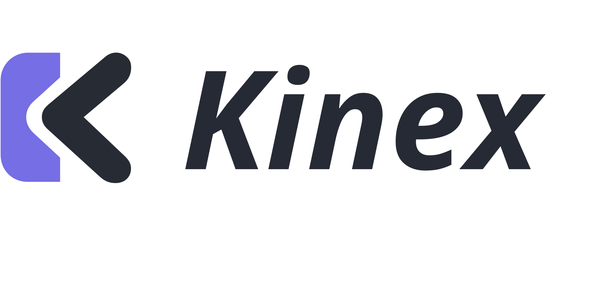

<p align="center">
  <picture>
    <source media="(prefers-color-scheme: dark)" srcset="assets/kinex-logo-text-night.svg">
    
  </picture>
</p>

<p align="center">
  A coding-agent harness for robots. Real hardware and simulators, from one terminal.
</p>

<p align="center">
  <a href="https://github.com/stacx-lab/kinex/actions/workflows/ci.yml"></a>
  <a href="https://github.com/stacx-lab/kinex/releases"></a>
  
  
</p>

<p align="center">
  <a href="#run-this-checkout">Run locally</a> ·
  <a href="#commands">Commands</a> ·
  <a href="#headless">Headless</a> ·
  <a href="#configuration-and-permissions">Configuration</a> ·
  <a href="#checks-and-packaging">Development</a>
</p>

A standalone robotics coding agent, powered by the published Pi SDK. Run `kinex`
for an interactive terminal or `kinex run` for a single task. No separate Pi
installation is required.

## Run this checkout

```sh
nvm use                         # Node 22.19 or newer
npm ci
npm run build
npm run dev
```

From a robot workspace:

```sh
cd /path/to/robot-workspace
/path/to/kinex/bin/kinex.mjs
```

Use `/login` to authenticate and `/model` to select a model. The provider catalog,
OAuth flows, streaming, retries, compaction and session history come from Pi
0.86.1. Existing provider API-key environment variables are supported by Pi.
Robot device commands work without model credentials.

Python 3 and uv are needed when using Python tools/drivers; ffmpeg is needed for
video encoding. Importing core or listing devices does not create Python. Kinex
prepares `.kinex/python` on demand and never activates it in the ordinary shell.

## Commands

| Command | Behavior |
| --- | --- |
| `/devices` | List device types and loaded intent. |
| `/load <device|all>` | Load a device and await initialization. |
| `/unload <device|all>` | Stop capture, release the device and its owned resources. |
| `/reload <device|all>` | Restart device drivers. Bare `/reload` reloads agent resources. |
| `/ping <device|all>` | Inspect existing services without starting them. |
| `/stop [device]` | Cancel the current agent response and stop loaded actuators. |
| `/unregister <device>` | Confirm, unload, and delete the device's local files. |
| `/record start arm=10 camera=2` | Start recording with per-device rates. |
| `/record snap <devices>` | Capture an observation. |
| `/record stop [success|failure|partial] [summary]` | Finish a recording. |
| `/record status` | Inspect current and recent recordings. |
| `/onboarding [description]` | Start a model-guided workspace setup. |
| `/register <type-or-template>` | Ask the model to prepare an unloaded profile. |
| `/calibrate [scope]` | Start a model-guided calibration workflow. |
| `/mode [ask|auto|yolo]` | Select the Kinex permission/interaction mode. |

Device names complete with Tab. General coding commands and keybindings use Pi's
TUI: `/model`, `/login`, `/settings`, `/new`, `/resume`, `/tree`, `/fork`, `/compact`,
`/export`, `/copy`, `/quit`. Some SDK help and diagnostics retain Pi terminology.
Use `kinex --continue` or `kinex --session <id|file>` to resume Kinex sessions.

Direct operations run without a model round trip. Only onboarding, registration
and calibration submit workflows to the model. Their implementation and help live
in the same core command catalog used by future host adapters.

## Headless

```sh
kinex run --auto "Inspect the workspace and read the loaded sensors"
kinex run "/devices"
kinex run "/load camera"
kinex run --auto --record "arm=10 camera=2" "Perform the task"
kinex run --auto --json "Inspect the workspace"
```

Use `--model provider/model`, `--thinking high`, `--continue`, or `--session` as
needed. `--effort` is an alias of `--thinking`. `--seed` submits an initial prompt
in interactive mode. Each headless process releases its drivers when it exits;
`loaded` intent persists and is restored by the next process.

## Configuration and permissions

Kinex uses separate storage from Pi and from legacy Kinex coding sessions:

| Path | Contents |
| --- | --- |
| `$KINEX_CONFIG_DIR/agent/settings.json` | Pi-format coding settings. |
| `$KINEX_CONFIG_DIR/agent/models.json` | Pi-format custom providers and models. |
| `$KINEX_DATA_DIR/agent/auth.json` | SDK credentials. |
| `$KINEX_DATA_DIR/agent/sessions/` | SDK JSONL sessions, grouped by workspace. |
| `.kinex/agent/settings.json` | Project coding settings. |
| `.kinex/kinex.json` or `kinex.json` | Existing core permissions and recording settings. |
| `.kinex/devices`, `tool`, `skill`, `recordings` | Existing robotics workspace content. |

The global defaults are `$XDG_CONFIG_HOME/kinex` (`~/.config/kinex`) and
`$XDG_DATA_HOME/kinex` (`~/.local/share/kinex`). Kinex's launcher sets Pi's documented
agent-directory override to the Kinex configuration directory. It does not use
`.pi` settings, extensions, skills, or system prompts. Project `AGENTS.md` and
`CLAUDE.md` instructions are loaded through the SDK. External Pi packages/resources
in agent settings are not supported in this first standalone delivery; use Kinex's
workspace tools and skills. Legacy coding settings, command templates and session
formats are not migrated.

For a local model, for example, `agent/models.json` can contain:

```json
{
  "providers": {
    "local": {
      "api": "openai-completions",
      "baseUrl": "http://localhost:11434/v1",
      "apiKey": "local",
      "models": [{ "id": "your-model-name" }]
    }
  }
}
```

Then select `local/your-model-name`. Model settings use Pi's format directly; Kinex
does not maintain a second provider implementation.

| Mode | Tool permissions | User questions |
| --- | --- | --- |
| Default interactive | Core rules; ask when unresolved | Enabled |
| `--auto` | Automatically allow | Enabled in the TUI |
| `--yolo` | Automatically allow | Disabled |
| Default headless | Core rules; deny unresolved asks | No interactive answers |

These are Kinex policies implemented using SDK hooks, not Pi-native CLI flags.
Write, edit and bash use the same allow/ask/deny rules as robotics tools; `shell`
is the permission name for bash. Approval can be once or for the session. Auto
modes override configured denies, matching the previous Kinex behavior. Stop is
always allowed. The model's `record` tool is available only with
`--enable-recording`; manual `/record` is always available. Unregister still needs
an explicit interactive confirmation. Tool approvals do not provide an OS sandbox.

## Runtime behavior

- A workspace owns the robotics runtime; a chat session does not own its drivers.
- New/resumed/forked sessions in the same workspace retain connections, cancel old
  calls, reset grants and finalize current recording. Switching workspace or
  quitting disposes drivers and subprocesses. Resource reload also finalizes recording.
- Core skills and tools keep workspace/global/builtin discovery precedence. After
  each completed tool batch, new/changed tool schemas and skill catalogs are
  available to the next model request, including headless runs without further
  user input. Edits to an existing tool's implementation or skill body are picked
  up on its next invocation. No file watcher wakes an idle or finished task.
- Stable instructions and tools remain stable. Changed runtime state is appended
  to the active conversation branch. Manual and automatic compaction include
  robotics summary requirements and restore a full current snapshot before the
  next model request. If snapshot recovery fails, work stops until it succeeds.
  Pi handles native tool additions where the model supports them; unsupported
  models and tool interface redefinitions can change the cached prefix. This is
  verified with local request fixtures, not measured live cache-hit rates.
- A tool batch containing any core tool or question executes in order, including
  mixed coding/robotics batches. Permission denial or cancellation stops later
  calls; completed work is not rolled back. Pure coding batches remain parallel.
- Images enter SDK history as bytes; replacing the source file does not change
  replay. Recording traces omit opaque provider reasoning and image bytes.
- UI loaded counts describe activation intent. `/ping` checks live service state.

See [DESIGN.md](DESIGN.md), [the core API](packages/core/README.md) and the
[refactor progress](PLAN.md).

## Checks and packaging

```sh
npm run typecheck
npm test                         # fake provider, CLI/package, real Linux/macOS PTY
npm run test:core                # core and independent npm consumption
npm run test:tui                 # after build
```

Tests use mock devices and a local HTTP provider; no paid model API is needed.
PTY tests need Python 3 and a POSIX host. Do not rebuild core while consumer tests
are running. Live provider cache rates and real robot task success require separate
environment-specific validation.

After building, `npm pack ./packages/core` and `npm pack` produce independent
tarballs. Until core is published, install both tarballs in one npm invocation:
`npm install /path/to/kinex-core-0.5.0.tgz /path/to/kinex-0.5.0.tgz`.
No registry publication or self-contained Node release is performed by these commands.

GitHub Actions runs type checking, core package tests and the full standalone suite
(including PTY interaction and package relocation) on pushes to `main` and pull
requests. CI uses the Node version in `.nvmrc` and Python 3.12; these tests need no
additional Python packages or physical devices.

Pushing a `v*` tag runs the same checks, verifies that the tag matches both package
versions, then creates a GitHub Release with `kinex-VERSION.tgz`,
`kinex-core-VERSION.tgz` and `SHA256SUMS`. These are npm packages requiring Node,
not bundled executables. Install both downloaded tarballs together (add `-g` for
a global CLI). The workflow does not publish to the npm registry.
