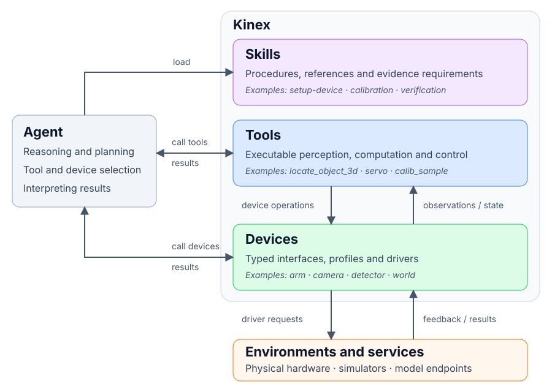

# RoboSkill-Distill

This research fork combines **Kinex + RoboTwin** to study VLM manipulation and
reusable tools formulated from failed attempts. The model chooses its own actions;
the harness records evidence, submits the native evaluator, and supports video-first
failure analysis. The toolbox is inherited experimental knowledge, not a no-tool
baseline or a guarantee of task success.

**Start here for this fork.** The upstream Kinex guide is retained below for
reference. Its installer downloads upstream Kinex; it does not install this fork's
experiment harness or prepare RoboTwin.

## Repository guide

- [`experiment/`](experiment/README.md): task definitions, shared launchers and evidence pipeline.
- [`toolbox/`](toolbox/README.md): active tools, concise interfaces, detailed manuals and provenance.
- [`experiment/prompts/robot_agent.txt`](experiment/prompts/robot_agent.txt): shared task-independent agent instruction.
- [`experiment/toolset.txt`](experiment/toolset.txt): custom tools exposed to the agent; dependencies are installed automatically.
- [`experiment/harness/`](experiment/harness/README.md): online records and offline audits; the recorder is observe-only.
- [`experiment/monitor/`](experiment/monitor/README.md): read-only live scene and tool-call dashboard.
- [`experiment/dependency-patches/`](experiment/dependency-patches/versions.json): pinned RoboEnv/RoboTwin revisions and patches.
- `packages/` and `src/`: upstream Kinex core, setup and standalone agent.
- `env/`: ignored local installations, caches, weights, configuration and secrets. Keep experiment source outside it.

Historical attempts are indexed in [`experiment/archive-index.json`](experiment/archive-index.json).
The external backup referenced there is not distributed with this repository.

## First check: no API or simulator required

Use Linux with Bash for the experiment scripts. Python 3 is sufficient for this
prompt-rendering check; full experiments additionally need Node.js >=22.19,
uv-managed Kinex Python >=3.11, FFmpeg and a working RoboTwin rendering environment.

```bash
git clone --branch kinex-experiments-20261029 https://github.com/Echoscd/RoboSkill-Distill.git
cd RoboSkill-Distill
KINEX_DRY_RUN=1 bash experiment/runtime/start-task.sh experiment/press-stapler
```

This creates an ignored run directory with `input-prompt.txt` and
`prompt-provenance.json`. It checks prompt rendering only; it does not validate
devices, credentials, IK, rendering or model availability.

## Prepare a machine before running an experiment

There is currently **no complete fresh-machine bootstrap script**. The launchers
assume the following local deployment exists:

```text
env/
  source/                       # built Kinex source matching this fork's revision
  RoboEnv/                      # pinned checkout, prepared RoboTwin and assets
  node/current/bin/             # Node runtime, or a compatible Node on PATH
  workspace/.kinex/             # workspace.yaml, exported devices and runtime Python
  config/agent/models.json      # local provider/model configuration
  config/kinex-env-proxy.cjs     # Node proxy preload used by the online launcher
  bin/kinex-via-pc               # local Kinex executable/wrapper
  secrets/openrouter_api_key     # key only; never commit it
```

1. Prepare RoboEnv/RoboTwin at the revisions in
   [`versions.json`](experiment/dependency-patches/versions.json). Apply each patch
   to its corresponding checkout with `git apply --check` before `git apply`.
   Install dependencies and download simulator assets separately; they are not in Git.
2. Build the Kinex source used by the launcher (`npm ci`, then `npm run build` in
   that source checkout). Keep it synchronized with the research fork. Editing this
   repository does not automatically update a separate `env/source` installation.
3. Export the ALOHA AgileX device profiles into `env/workspace` using the
   [upstream simulator setup](#use-kinex-with-simulators), and prepare its runtime Python.
4. Configure a model provider and put its key in the local key file. The default
   model identifier is `openrouter/qwen/qwen3.8-max-0902`; check that your provider
   actually offers it, or set `KINEX_EXPERIMENT_MODEL` to an available model.
5. Review [`common.sh`](experiment/runtime/common.sh) and
   [`run-agent.sh`](experiment/harness/online/run-agent.sh) before launch. Some
   defaults are specific to the original development machine. Set `ROBOTWIN_PYTHON`
   to your interpreter and `KINEX_PC_PROXY_URL` to your reachable HTTP proxy.
   The current online launcher requires the local proxy preload shown above;
   proxy-free deployment needs launcher/preload adaptation.

`KINEX_ENV_ROOT`, `KINEX_BASE_WORKSPACE`, `KINEX_BIN`, `OPENROUTER_KEY_FILE`,
`ROBOENV_ROOT` and `ROBOENV_PYTHON_PATH` customize single-task deployment paths.
The suite runner currently discovers its catalog under **repository-local
`env/RoboEnv`**, so moving only `KINEX_ENV_ROOT` does not relocate that catalog.

Neither environments nor provider configuration, credentials, model weights or
generated recordings are included in this repository. Keep sensitive files local;
inspect traces and configuration before sharing an evidence directory.

## Run one task on a prepared machine

From the repository root:

```bash
export ROBOTWIN_PYTHON=/absolute/path/to/robotwin/bin/python
export KINEX_PC_PROXY_URL=http://127.0.0.1:18080  # replace with your working proxy

bash experiment/runtime/start-task.sh experiment/press-stapler
# Other task definitions use the same launcher:
# bash experiment/runtime/start-task.sh experiment/click-bell
# bash experiment/runtime/start-task.sh experiment/turn-switch
```

By default, evidence is written to
`experiment/<task>/runs/autonomous/<UTC_TIMESTAMP>/`. To select an output location,
pass a second argument using a **new, unused directory**:

```bash
bash experiment/runtime/start-task.sh experiment/turn-switch \
  experiment/turn-switch/runs/autonomous/my_unique_attempt
```

The action phase defaults to 600 seconds and failure diagnosis to 360 seconds;
initialization and finalization add time. Override them with
`KINEX_EXPERIMENT_TIMEOUT_S` and `KINEX_FAILURE_ANALYSIS_TIMEOUT_S`.

The flow is: render the common prompt with the task goal, deploy tools, start and
record the simulator, run the model, submit the native evaluator, attempt read-only
video diagnosis on failure, then finalize evidence and HTML. Diagnosis may itself
fail or time out; check its logs rather than assuming a diagnosis was produced.

Task folders separate the model's goal (`task.json`) from evaluator-side scene,
seed and budget (`task.yaml`). For another task, keep these definitions consistent
and reuse the shared launcher. Do not insert a prescribed action sequence or old
iteration history into the shared prompt.

## Inspect a run

Open `<RUN_DIR>/trace.html` for offline review. Important evidence files are:

- `agent/primary-session.jsonl`: recorded action-phase model messages and tool I/O.
- `agent/events.jsonl` and `harness-events.jsonl`: model stream and online device/tool records.
- `agent/failure-analysis-session.jsonl`: separate diagnosis session, when created.
- `simulator-verdict.json`: supervisor-submitted native evaluator result.
- `trace-manifest.json` and `harness-audit.json`: artifact inventory and evidence audit, when available.
- `roboenv/<session>/evidence/recording/`: simulator videos and frame metadata, when recording started.
- `agent/run-state.txt`, `agent/stderr.log` and launch logs: process state and runtime failures.

Finalization is attempted on success, failure and timeout. If startup fails before
a model session or recording exists, HTML can be a fallback report; missing
evidence must remain explicit. See [`experiment/lib/README.md`](experiment/lib/README.md).

For live supervision, run `bash experiment/monitor/start.sh` on the development
machine. It listens on `127.0.0.1:8765` by default. From your workstation, forward
that port with `ssh -N -L 8765:127.0.0.1:8765 YOUR_SSH_HOST`, then open
<http://127.0.0.1:8765>. Keep the monitor on loopback; it exposes experiment data.

## Run the installed RoboTwin catalog

After the same environment is prepared:

```bash
"$ROBOTWIN_PYTHON" experiment/benchmark/run_suite.py \
  --batch-dir experiment/benchmark/runs/my_unique_batch --seed 0
```

This selects the installed ALOHA AgileX catalog, runs serially with `demo_clean`
and no seed substitution, and saves a full attempt per task. Inspect
`suite-state.json` for progress, `suite-results.json` for results and
`suite-manifest.json` for configuration and source hashes.

Do not run another task launcher against the same shared device profiles while a
suite is active. The suite lock prevents a second suite driver, not independent
single-task launches. Do not edit fingerprinted runtime, prompt or tool files
mid-batch: the next task will stop with `source_changed`. Use a new batch after
changes. A `STOP_AFTER_CURRENT` file inside the batch directory stops the queue
after the active task. Resume skips completed jobs and preserves incomplete
attempts rather than overwriting them.

## Interpret results and current limitations

- **Native result, agent claim and process exit are separate facts.** A model
  claiming success does not establish task success. A timeout can occur after
  native success; conversely, a clean process exit can leave the task unfinished.
- Separate simulator startup errors and provider/API interruptions from completed
  manipulation attempts. Do not treat every `native_success=false` as the same
  model capability failure.
- This suite is a single-seed coverage pass under
  `absolute_joint_position_25hz_practice`, **not an official multi-seed RoboTwin score**.
- IK feasibility does not establish collision clearance. Without a collision
  context, planning explicitly returns `collision_validation.status=unverified`.
  The model may choose to skip these optional tools; inspect actual calls.
- Scene maps cover observed surfaces. Current collision checks are sampled and
  conservative, with incomplete gripper geometry and no continuous or simultaneous
  dual-arm safety guarantee. TCP-origin contact is not calibrated finger-pad contact.
- Blocking motion/world waits have timed out in current runs. Submission,
  completion and measured arrival need separate inspection; timeout alone does not
  identify a collision or prove no motion occurred.
- The stapler's current native criterion checks contact with a static actor; it
  does not demonstrate full physical compression.

For new tools, follow [`toolbox/README.md`](toolbox/README.md): keep the runtime
`tool.yaml` concise, put detailed parameter semantics/examples in `toolbook.yaml`,
record generality and complexity in `metadata.json`, and retain failure records,
tests and append-only `changes.jsonl` history. High-level tools compose lower-level
capabilities. Keep research notes and diagnosis out of the task-independent prompt.

## Upstream Kinex reference

The original usage guide, licenses and attribution follow. For the research
pipeline above, use the fork's checked-out source and launchers.

---

<p align="center">
  
  
</p>

<p align="center">
  <a href="https://github.com/stacx-lab/kinex/releases">
    
  </a>
  <a href="https://github.com/stacx-lab/kinex/actions/workflows/ci.yml">
    
  </a>
  <a href="LICENSE">
    
  </a>
  <a href="#getting-started">
    
  </a>
  <a href="#getting-started">
    
  </a>
</p>

<p align="center">
  <a href="https://stacx-lab.github.io/kinex/docs/">Documentation</a> ·
  <a href="#news">News</a> ·
  <a href="#getting-started">Getting Started</a> ·
  <a href="#use-kinex-with-simulators">Simulators</a> ·
  <a href="#use-kinex-with-real-world-robots">Real-World Robots</a> ·
  <a href="#disclaimer">Disclaimer</a> ·
  <a href="#kinex-and-the-pi-ecosystem">Pi Ecosystem</a> ·
  <a href="#using-kinex-with-other-harnesses">Other Harnesses</a>
</p>

Kinex is a robotics harness for coding agents, built on the published Pi SDK.
Its three layers—**devices**, **tools**, and **skills**—provide environment access,
executable operations, and task guidance.

Read the [documentation website](https://stacx-lab.github.io/kinex/docs/) for
setup guides, concepts and command references.

<p align="center">
  
</p>

## News

- **2026.10.15**: Kinex v1.0.0 is released! Visit the [project website](https://stacx-lab.github.io/kinex/).

## Getting Started

Install on Linux or macOS:

```sh
curl -fsSL https://raw.githubusercontent.com/stacx-lab/kinex/main/install.sh | bash
```

The installer reuses Node.js ≥22.19 and npm, or offers to install them if needed.
Follow any PATH instructions it prints, then start Kinex in your project:

```sh
cd /path/to/project
kinex
```

Use `/login` to connect a model provider and `/model` to choose a model.
Default Python tools and drivers use a uv-managed Python ≥3.11 environment;
install uv before first use. Video encoding requires ffmpeg.

You can also run a single task, resume a session, or update from the shell:

```sh
kinex "Inspect the workspace"          # Start with a prompt
kinex run "/ping left_arm"             # Run once without a model
kinex run "Describe the scene"         # Run a task and exit; -p also works
kinex --continue                       # Resume the latest project session
kinex --resume                         # Choose a previous session
kinex --model provider/model           # Start with a selected model
kinex update                           # Update Kinex and its bundled Pi SDK
kinex --help                           # All commands and options
```

See the [command reference](https://stacx-lab.github.io/kinex/docs/slash-commands/)
for in-session commands.

## Use Kinex with Simulators

[RoboEnv](https://github.com/stacx-lab/RoboEnv) exposes simulated robots as Kinex
devices. Follow the [simulator setup guide](https://stacx-lab.github.io/kinex/docs/simulators/#1-launch-a-simulator),
then prepare RoboTwin and launch the block-handover task from the RoboEnv checkout:

```sh
source .venv/bin/activate
roboenv prepare robotwin
roboenv launch robotwin/handover-block-aloha-agilex --port 8123 --record ./recordings/demo
```

The `--record ./recordings/demo` option records the episode as videos in that
directory (requires FFmpeg). Omit it if you do not want to record.

Wait for `Ready` and leave it running. In a second terminal, create a workspace
and export the task's paired Aloha AgileX devices. `launch` takes the **task ID**;
`setup` takes its **robot ID**:

```sh
source /path/to/RoboEnv/.venv/bin/activate
mkdir -p kinex-sim-workspace
cd kinex-sim-workspace
roboenv setup robotwin/robotwin-aloha-agilex
export ROBOENV_ENDPOINT=http://127.0.0.1:8123
kinex
```

Replace `/path/to/RoboEnv` with your checkout. In Kinex, run `/load all` and
`/ping all`, then ask:

> Use the left arm to grasp the red block on the table, hand it over to the right
> arm, and set it down in the center of the blue pad. Release it with the right
> gripper open.

After the task finishes, press Ctrl-C in the RoboEnv terminal to close the
simulator. If you'd like to review the handover, inspect the recorded videos in
`recordings/demo` under your RoboEnv checkout.

To try other tasks,
use `roboenv tasks list --simulator robotwin` and
`roboenv robots list --simulator robotwin`; the task YAML's `robot:` field gives
its paired robot ID. See the
[simulator walkthrough](https://stacx-lab.github.io/kinex/docs/simulators/)
for more setup and connection details.

## Use Kinex with Real-World Robots

Open Kinex in your robot workspace and describe your hardware, how it connects,
and the task you want to perform:

```text
/onboarding Set up my robot arm, gripper, and overhead camera to pick objects from the table.
```

Onboarding helps connect devices and prepare the task's prerequisites, reusing
existing profiles and calibration. Use `/devices` to inspect the workspace,
`/load <device>` to connect an inactive device, and `/ping all` to check connections.
If the task needs additional calibration, request its scope, for example
`/calibrate camera-to-arm transform for picking`.

Once ready, give Kinex the task in plain language. Use `/stop` to cancel the
response and stop actuators within their declared scope, or `/unload <device>`
to release a device. See [onboarding and calibration](https://stacx-lab.github.io/kinex/docs/onboarding/)
for more detail.

## Disclaimer

Kinex is provided "AS IS", without warranties, under the [Apache License 2.0](LICENSE).
Users are responsible for safe operation. Always supervise real robots, keep a
physical emergency stop within reach, and verify motion limits before running
tasks. Software commands such as `/stop` do not replace a hardware emergency stop.

## Kinex and the Pi Ecosystem

Kinex is built on [Pi](https://pi.dev) and supports Pi plugins: extensions,
skills, prompt templates and themes. Install packages from npm, Git or a local
folder using the same package format.

Kinex includes [pi-web-search](https://www.npmjs.com/package/pi-web-search) for web
search and [pi-btw](https://www.npmjs.com/package/pi-btw) for side conversations.
You can also bring your own Pi skills, prompts and themes.

```sh
kinex install npm:pi-web-search         # Override the bundled version
kinex install ./my-pi-package -l        # Add a package to this project
kinex list                             # Show installed and bundled packages
kinex update --extensions              # Update packages, preserving version pins
kinex remove npm:pi-web-search          # Restore the bundled fallback
```

Installs default to user scope; `-l` selects the project. Restart after changing
packages. Browse [Pi packages](https://pi.dev/packages) or read the
[package documentation](https://github.com/earendil-works/pi/blob/v1.2.0/packages/coding-agent/docs/packages.md).

## Using Kinex with Other Harnesses

Kinex plugins currently support **Pi, Claude Code and Codex**. They package Kinex's
device tools, skills and robot context through a shared MCP adapter, with Pi also
providing direct lifecycle commands and UI integration. They are maintained in the separate
[kinex-plugins repository](https://github.com/stacx-lab/kinex-plugins).
OpenCode is not currently supported.

Choose your harness there, follow its installation and configuration instructions,
then open your robot workspace in that harness and explicitly request “Start
Kinex.” Use “Show Kinex status” to inspect the runtime and “End Kinex” to release
devices while keeping the host open. Pi also provides `/kinex-start`,
`/kinex-status` and `/kinex-end` as direct commands.

Plugins retain the host's coding workflow and use host-managed approvals by
default; standalone Kinex is not required. Plugin releases and their bundled
core/setup snapshots are updated independently.

## Contributing & Development

Issues and pull requests are welcome. Read [AGENTS.md](AGENTS.md) for contribution
rules, [architecture](https://stacx-lab.github.io/kinex/docs/architecture/#packages)
for package boundaries, and [runtime documentation](https://stacx-lab.github.io/kinex/docs/runtime/)
for workspace discovery and resource lifecycle.
The [device](https://stacx-lab.github.io/kinex/docs/devices/) and
[onboarding](https://stacx-lab.github.io/kinex/docs/onboarding/) guides cover
device control, setup and calibration.

For source development:

```sh
git clone https://github.com/stacx-lab/kinex.git
cd kinex
nvm use
npm ci
npm run build
npm run dev
```

Before submitting code changes, install the Python test dependencies and run the
full check (Node ≥22.19, Python 3 and a POSIX host):

```sh
python3 -m pip install -r packages/core/test/requirements.txt -r packages/setup/test/requirements.txt
npm run check
```

The check builds once and covers core, setup, standalone, PTY and packed consumers.
Do not rebuild packages while consumer tests run. Documentation-only edits need
link and diff checks. [Native ROS checks](packages/setup/test/container/README.md)
run separately.

## Acknowledgements

Kinex builds on [Pi](https://github.com/earendil-works/pi). Its published SDKs
provide the model integrations, coding tools, agent loop, session management and
terminal UI. Thanks to the Pi maintainers and community for the foundation and
plugin ecosystem that make Kinex possible.

## License

Kinex is licensed under the [Apache License, Version 2.0](LICENSE).

Third-party components retain their own licenses. See
[third-party notices](THIRD_PARTY_NOTICES.txt) for Pi's MIT license and attribution.
